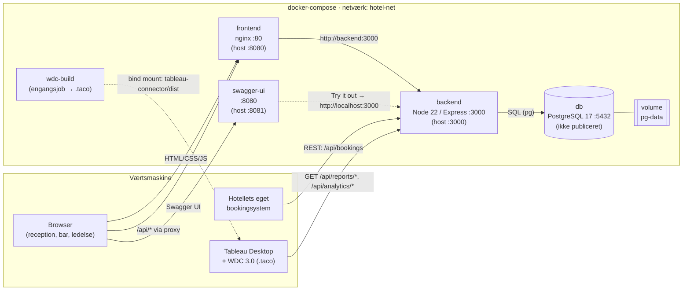
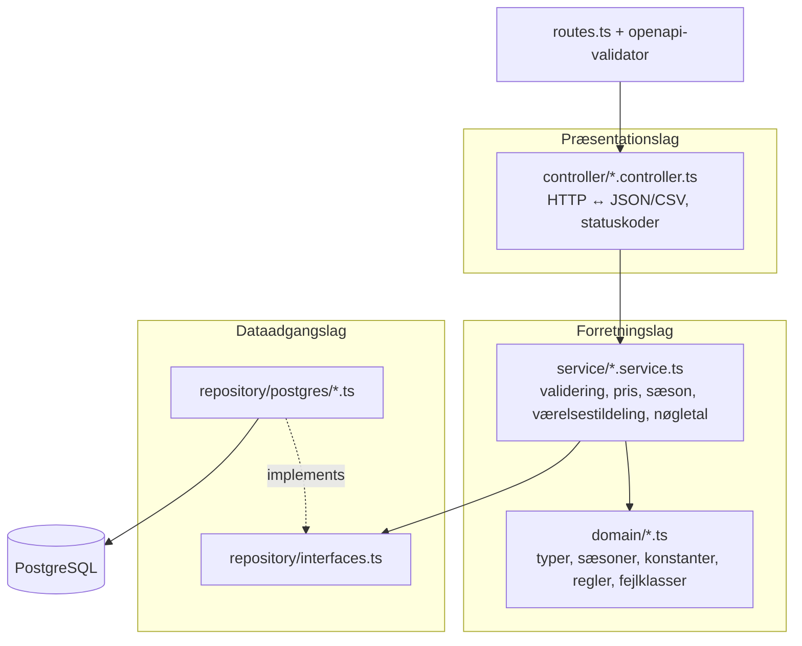

# Hotel Kong Arthur – booking og analytics

Et system, der gør Hotel Kong Arthurs historiske CSV-data til et levende driftssystem. Receptionen
opretter, redigerer og sletter bookinger. Bartenderen registrerer salg i lobbybaren. Hotellets og
barens nøgletal beregnes i backenden og kan aflæses tre steder: direkte som JSON i REST API'et,
på frontendens nøgletalsside og i et Tableau-dashboard via Web Data Connector 3.0.

Projektet er lavet i SWA 2026 på KEA med GitHub Spec Kit. Specifikation, plan og opgaver ligger i
[`specs/001-hotel-analytics-platform/`](specs/001-hotel-analytics-platform/).

## Indhold

- [Kom i gang](#kom-i-gang)
- [Arkitektur](#arkitektur)
- [Et request trin for trin](#et-request-trin-for-trin)
- [Lagene i backenden](#lagene-i-backenden)
- [REST API](#rest-api)
- [Domænet](#domænet)
- [Test](#test)
- [Tableau](#tableau)
- [SWA-eksamen: de 10 tillægsspørgsmål](#swa-eksamen-de-10-tillægsspørgsmål)

## Kom i gang

**Krav:** Docker Desktop. Node.js 22 er kun nødvendig til lokal udvikling uden Docker, og Tableau
Desktop 2025.2 eller nyere kun til dashboardet.

```bash
git clone https://github.com/SebastianHoilund/Projekt-HotelKongArthur.git
cd Projekt-HotelKongArthur
docker-compose up --build
```

Første opstart tager omkring et minut: images bygges, databasen oprettes, migrationerne kører, og de
1.000 historiske bookinger og 30 drinks indlæses. Der skal ikke laves en `.env`-fil, for alle
værdier har defaults (se `.env.example`).

| Adresse | Indhold |
|---|---|
| http://localhost:8080 | Frontend: bookinger |
| http://localhost:8080/analytics.html | Frontend: nøgletal |
| http://localhost:8081 | Swagger UI (API-dokumentation, "Try it out") |
| http://localhost:3000/api | REST API, fx `/api/analytics/summary?year=2026` |
| `tableau-connector/dist/*.taco` | Tableau-connectoren, bygget af `wdc-build` |

`docker-compose down` stopper systemet og beholder data. `docker-compose down -v` sletter også
databasen, så næste opstart starter forfra med de historiske data.

## Arkitektur



| Container | Image | Rolle |
|---|---|---|
| `db` | `postgres:17` | Databasen. Porten publiceres ikke, så kun backenden kan nå den |
| `backend` | `backend/Dockerfile` (`runtime`) | REST API med al forretningslogik. Kører migrationer og seed ved opstart |
| `frontend` | `frontend/Dockerfile` (`nginx:alpine`) | Statiske sider. Proxier `/api/` til backenden, så browseren kun taler med én origin |
| `swagger-ui` | `swaggerapi/swagger-ui` | Viser `api/openapi.yaml` |
| `wdc-build` | `tableau-connector/Dockerfile` | Engangsjob, der bygger Tableau-connectoren og lægger `.taco` i `tableau-connector/dist/` |
| `backend-test` | `backend/Dockerfile` (`test`) | Kun med `--profile test`: integrationstests mod en separat testdatabase |

Al kommunikation går gennem REST API'et. Hverken frontend, Swagger eller Tableau har adgang til
databasen.

## Et request trin for trin

Receptionisten opretter en booking i frontenden:

1. **Browser:** `js/bookings.js` læser formularen og kalder `api.createBooking()` i `js/api.js`, som
   sender `POST /api/bookings` med JSON. Frontenden beregner ingen pris eller sæson.
2. **nginx** (`frontend`) modtager kaldet på port 8080 og proxier alt under `/api/` til
   `http://backend:3000`. Navnet `backend` slås op i Dockers DNS på netværket `hotel-net`.
3. **Express** (`backend/src/app.ts`): `express.json()` læser body, og `express-openapi-validator`
   tjekker request mod `api/openapi.yaml`. Forkerte typer, manglende felter og ukendte felter giver
   400, før vores kode kører.
4. **Controller** (`controller/booking.controller.ts`) sender body videre til
   `BookingService.create()`.
5. **Service** (`service/booking.service.ts`) validerer forretningsreglerne: udtjekning efter
   indtjekning og antal gæster inden for typens kapacitet. Den beregner nætter, sæson og pris
   (`PricingService`) og åbner en transaktion via `UnitOfWork`.
6. **Repository** (`repository/postgres/`): `RoomRepository.findByType(..., { forUpdate: true })`
   låser typens værelser med `SELECT … FOR UPDATE`. `BookingRepository.findByRoomsInPeriod()`
   henter de bookinger, der kan ramme perioden.
7. **Service** vælger laveste ledige værelse med overlapreglen fra `domain/booking-rules.ts`. Hvis
   intet er ledigt, kastes `ConflictError`. Ellers oprettes gæst og booking, og transaktionen
   committes.
8. **PostgreSQL** gemmer rækkerne i `guest` og `booking` på volumen `pg-data`.
9. **Svaret** går samme vej tilbage. Controlleren svarer `201 Created` med
   `Location: /api/bookings/{id}` og den gemte booking. Fejl bliver til `400`, `404` eller `409` i
   `middleware/error-handler.ts`, altid i formatet `{ "error": { "code", "message", "details" } }`.
10. **Browser:** `bookings.js` genindlæser listen og viser værelse, sæson, nætter og pris fra svaret.

## Lagene i backenden



| Lag | Mapper | Ansvar | Må ikke |
|---|---|---|---|
| Præsentation | `controller/`, `middleware/` | Oversætte HTTP til kald af services og svar til JSON/CSV med rigtig statuskode | Kende repositories eller SQL |
| Forretning | `service/`, `domain/` | Alle regler og beregninger: validering, sæson, pris, overlap, værelsestildeling og alle nøgletal | Kende Express eller `pg` |
| Dataadgang | `repository/` | Hente og gemme. Repositories returnerer domæneobjekter og indeholder ingen forretningsregler | Indeholde forretningsregler |

Grænserne håndhæves af ESLint (`backend/eslint.config.js`): en controller, der importerer et
repository, eller en service, der importerer Express eller `pg`, giver en lint-fejl.
Sammenkoblingen sker ét sted, i `app.ts`, hvor PostgreSQL-implementeringerne gives til
services (manuel dependency injection).

**Udskiftelighed i praksis.** Projektet startede på MySQL. Da kunden i uge 2 krævede en anden
database, blev der skiftet til PostgreSQL. Ændringerne lå i `repository/postgres/` (tidligere
`repository/mysql/`), `db/`, `config/env.ts`, `app.ts`, `server.ts` og `docker-compose.yml`.
Domænet, `repository/interfaces.ts`, middleware og API-kontrakten var uændrede. Services og
controllere blev skrevet bagefter mod de samme interfaces og har aldrig importeret noget fra
databaselaget. Versionen med MySQL er bevaret i git-tagget `v1.0-mysql`.

## REST API

Kontrakten er [`api/openapi.yaml`](api/openapi.yaml) (OpenAPI 3.1) og kan prøves i Swagger UI på
http://localhost:8081.

| Ressource | Endpoints |
|---|---|
| Bookinger | `GET/POST /api/bookings`, `GET/PUT/DELETE /api/bookings/{id}` (filtre: `year`, `roomType`, `country`, `season`) |
| Værelser | `GET /api/room-types`, `GET /api/room-types/{id}`, `GET /api/rooms?roomType=&availableFrom=&availableTo=` |
| Bar | `GET /api/drinks`, `GET /api/drinks/{id}`, `GET/POST /api/drink-sales` |
| Nøgletal | `GET /api/analytics/summary`, `/occupancy`, `/revenue/room-types`, `/revenue/countries`, `/satisfaction`, `/bar` (alle med `?year=`) |
| Rapporter | `GET /api/reports/bookings`, `GET /api/reports/drink-sales` (`?year=&format=json\|csv`) |
| Drift | `GET /api/health` |

Statuskoder: `200` læst eller opdateret, `201` oprettet (med `Location`), `204` slettet, `400`
ugyldigt input, `404` findes ikke, `409` intet ledigt værelse og `500` uventet fejl.

## Domænet

Reglerne og tallene står i
[`reference-data.md`](specs/001-hotel-analytics-platform/reference-data.md).

- **Kapacitet:** 214 værelser fordelt på 8 typer, i alt plads til 428 gæster. Kapaciteten skaleres
  aldrig, så 2026 har 214 × 365 = 78.110 tilgængelige værelsesnætter.
- **Sæsoner** (efter indtjekningsdato): lav = januar, februar, november og 1.–15. december. Mellem =
  marts–maj, september og oktober. Høj = juni–august og 16.–31. december.
- **Pris:** takst for typen og sæsonen × antal nætter, medmindre der angives en manuel pris. De
  historiske priser er bevaret uændret.
- **Overlap:** to bookinger på samme værelse overlapper, hvis `indtjek₁ < udtjek₂` og
  `udtjek₁ > indtjek₂`. Udtjekning samme dag som næste indtjekning er tilladt.
- **Nøgletal:** belægningsgrad = solgte nætter ÷ tilgængelige nætter. ADR = indtjening ÷ solgte
  nætter. RevPAR = indtjening ÷ tilgængelige nætter. ALOS = gennemsnitligt antal nætter pr. booking.
  Hele bookingen tæller i indtjekningens år, sæson og måned.

Forventede tal for 2026 efter seed: 1.000 bookinger, 5.379 solgte nætter, belægningsgrad 6,89 %,
tilfredshed 3,87 (705 svar) og barsalg 13.448.640,34 kr.

## Test

```bash
# Unit-tests (forretningslogik med repositories i hukommelsen)
cd backend && npm ci && npm test

# Lint (inkl. lagregler) og formatering
npm run lint && npx prettier --check .

# Integrationstests mod PostgreSQL. Alle svar valideres mod api/openapi.yaml.
docker-compose --profile test run --rm backend-test
```

Integrationstestene kører mod databasen `hotel_kong_arthur_test` med brugeren `hotel_test`. De
oprettes af `db/init/`, første gang `pg-data` er tom. Har du en database fra før, så kør
`docker-compose down -v` først.

Manuelle scenarier, fx overlap, samtidige bookinger og live-opdatering af Tableau, står i
[`quickstart.md`](specs/001-hotel-analytics-platform/quickstart.md).

## Tableau

Se [`tableau/README.md`](tableau/README.md): start Tableau Desktop med connectoren og udvikler-wrapperen
(`-DEPSPath` for localhost-adgang), vælg år, og hent de 8 tabeller (bookinger, nøgletal, indtjening pr. type og sæson,
pr. land, belægning, tilfredshed og baren). **Data → [Datakilde] → Extract → Refresh** henter de aktuelle tal fra API'et live.
Kan connectoren ikke køre, kan `/api/reports/*?format=csv` bruges som backup.

## SWA-eksamen: de 10 tillægsspørgsmål

Kort udgangspunkt til fremlæggelsen. Hvert svar henviser til, hvor det kan vises i koden.

### 1. Arkitekturdiagrammet

Systemet består af fem containere og tre klienter, se [Arkitektur](#arkitektur). Alle klienter
(browser, Swagger UI, Tableau og hotellets eget bookingsystem) taler HTTP/JSON med backenden. Kun
backenden taler SQL med databasen, og databasens port er ikke publiceret. Frontendens nginx er
både webserver og reverse proxy, så browseren kun skal kende én adresse. `wdc-build` kører kun ved
opstart og laver Tableau-connectoren.

### 2. Følg et request

Se [Et request trin for trin](#et-request-trin-for-trin). Pointen er, at hvert trin har ét ansvar:
nginx router, validatoren tjekker kontrakten, controlleren oversætter HTTP, servicen træffer
beslutningerne, og repositoryet skriver SQL. Databasen er PostgreSQL, ikke MySQL, se spørgsmål 5.

### 3. 3-lags arkitektur

Se [Lagene i backenden](#lagene-i-backenden). Grænserne er mapperne `controller/`, `service/` og
`repository/`, og de håndhæves af ESLint. **Bevidst placering:** Overlapreglen ligger i
`domain/booking-rules.ts` og bruges af `BookingService`, ikke i en database-trigger, en
`CHECK`-constraint eller i frontenden. Repositoryet leverer kun kandidaterne
(`findByRoomsInPeriod`). Derfor kan reglen unit-testes uden database
(`tests/unit/booking.service.test.ts`), og den gælder for alle klienter.

### 4. Forretningslogikkens placering

Alle nøgletal beregnes i `service/analytics.service.ts` som rene funktioner over rækkerne fra
repositoryet. Databasen bruges kun til at hente data, og Tableau og frontenden viser kun tallene.
**Hvorfor:** Én definition giver samme tal i API, frontend og Tableau (SC-008). Det kan testes med
faste data, fx at 5.379 ÷ 78.110 giver 6,89 %, og formlerne er skrevet i TypeScript, som hele
gruppen kan læse. **Hvis det flyttes til Tableau**, får hver klient sin egen version af
formlerne, og frontenden og hotellets bookingsystem kan ikke få de samme tal. **Hvis det flyttes
til SQL** (`GROUP BY` eller views), bliver det hurtigere ved store datamængder, men reglerne
bliver delt mellem SQL og TypeScript og sværere at unit-teste.

### 5. Udskiftelighed

Det er ikke teoretisk, for det er sket. Skiftet fra MySQL til PostgreSQL rørte kun
dataadgangslaget, migrationerne, konfigurationen, sammenkoblingen i `app.ts` og
`docker-compose.yml`. Domænet, repository-interfaces og API-kontrakten var uændrede. Alle senere
services er skrevet mod `repository/interfaces.ts` og kender hverken `pg` eller SQL, hvilket
lint-reglerne nu håndhæver. Et nyt databaseskift vil derfor igen kun ramme `repository/postgres/`,
`db/`, `config/env.ts` og `app.ts`. **Frontenden** kan udskiftes med hotellets eget bookingsystem uden
ændringer i backenden. Det bruger samme endpoints og samme kontrakt, og alle regler håndhæves i
backenden, så en ny klient ikke kan omgå dem. Det viser, at afhængighederne kun peger én vej:
præsentation → forretning → dataadgang.

### 6. REST-design

Ressourcerne er navneord i flertal, der afspejler domænet: `bookings`, `room-types`, `rooms`,
`drinks` og `drink-sales`. Beregnede tal ligger under `analytics/` og fakta-tabeller under
`reports/`. **Eksempel:** `POST /api/bookings` opretter og svarer `201` med `Location`. `GET`
henter, `PUT /api/bookings/{id}` erstatter, og `DELETE` sletter og svarer `204`. Fejl giver `400`
ved ugyldigt input, `404` når ressourcen ikke findes, og `409` når ressourcen er i konflikt med en
anden (intet ledigt værelse). Klienten sender kun det, receptionisten ved (gæst, type, datoer og
antal), mens sæson, nætter, pris og værelsesnummer kommer fra serveren. Domænets
`Booking` → `Guest` → `Room` → `RoomType` ses direkte i svaret.

### 7. API-kontrakten

`api/openapi.yaml` er kontrakten, som både kode og klienter retter sig efter. Kunderne er
frontenden, Tableau-connectoren, Swagger UI og hotellets eget bookingsystem. **Overensstemmelse
sikres i koden:** `express-openapi-validator` afviser requests, der ikke følger kontrakten. I test
(`NODE_ENV=test`) valideres også alle **svar**, så integrationstestene fejler, hvis backenden
returnerer noget, kontrakten ikke tillader. Det fangede en reel fejl: `Guest` var defineret med
`allOf` og `additionalProperties: false` og afviste derfor sit eget `id`.

### 8. Docker og docker-compose

Se tabellen under [Arkitektur](#arkitektur). `docker-compose up` bygger images, opretter netværket
`hotel-net` og volumen `pg-data` og starter containerne. **Containerne finder hinanden** via
service-navne i Dockers DNS (`db`, `backend`). **Rækkefølgen** styres af healthchecks og
`depends_on: condition: service_healthy`:
- `db` er først klar, når `pg_isready` svarer over TCP.
- `backend` starter først, når databasen er klar. Den kører migrationer og seed, før den svarer på
  `/api/health`, og har `restart: on-failure`.
- `frontend` venter på, at backenden er healthy.

**Data** ligger i den navngivne volume `pg-data`. Den overlever `docker-compose down` og genstarter.
Seed kører kun én gang, registreret i `schema_migrations`, så data aldrig indlæses dobbelt. Først
`docker-compose down -v` sletter data.

### 9. Fra statisk til live data

CSV-filerne bruges kun én gang som startdata. Derefter er databasen kilden, og alle ændringer går
gennem API'et: bookinger fra frontenden eller et andet system og barsalg via `POST
/api/drink-sales`. Nøgletallene beregnes ved hvert kald uden cache, så en ny booking slår igennem
med det samme. **Tableau** henter data via Web Data Connector 3.0 (`tableau-connector/`), som
kalder `/api/reports/bookings` og `/api/analytics/*` og laver 8 tabeller. **Data → Refresh** i
Tableau kalder API'et igen. Tableau har ingen adgang til databasen og beregner ingen nøgletal selv.

### 10. Ejerskab og vurdering

> Dette afsnit skal gruppen selv kunne stå inde for. Eksemplerne nedenfor er reelle beslutninger
> fra forløbet og kan bruges som udgangspunkt.

- **Ændret:** AI'en definerede `Guest` i kontrakten som `allOf` med `GuestInput`. Responsvalideringen
  afslørede, at det afviste `id`, så skemaet blev skrevet om. Seed blev også ændret: AI'ens forslag
  var "seed, hvis `booking` er tom". Det blev erstattet af en markør i `schema_migrations`, fordi
  seed ellers ville køre igen, hvis alle bookinger blev slettet.
- **Beholdt:** Nøgletallene beregnes i TypeScript over alle årets rækker i stedet for i SQL. Det
  holder logikken ét sted og gør den testbar, og med ~1.000 rækker tager det få millisekunder.
- **Største svaghed i produktion:** Der er **ingen autentificering eller autorisation**. Alle, der
  kan nå API'et, kan oprette og slette bookinger, og gæsteoplysninger er åbne. Derudover henter
  nøgletallene alle årets bookinger ved hvert kald, hvilket ikke skalerer til hundredtusindvis af
  rækker. Der kører også kun én backend-instans uden overvågning.
