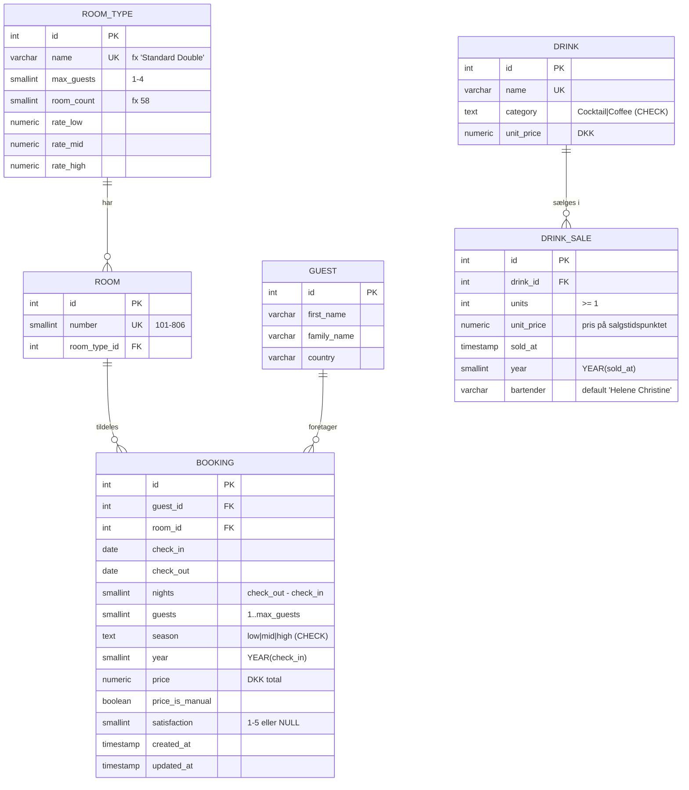
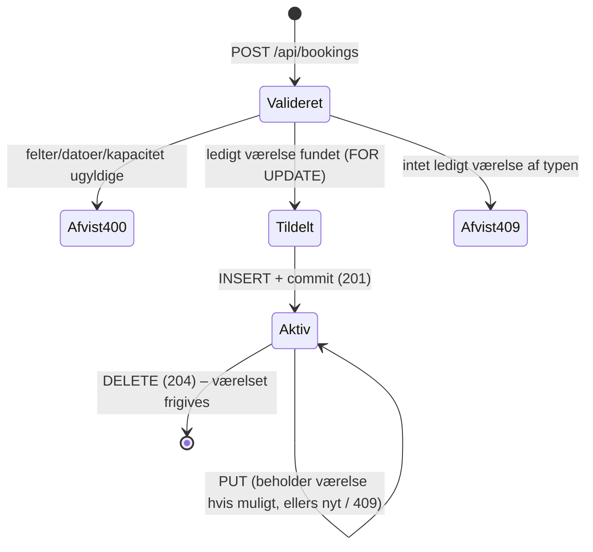

# Data Model: Hotel Kong Arthur

**Feature**: `001-hotel-analytics-platform` | **Date**: 2026-10-29 | **Plan**: [plan.md](plan.md)

Værdier for sæsoner, takster og værelser kommer fra [reference-data.md](reference-data.md). Tabellerne er PostgreSQL 17 (UTF-8). Alle datoer er `DATE` (ingen tidszone). Beløb er `NUMERIC`. Indtil 2026-11-02 var databasen MySQL; oversættelsen af typerne står i research R-17.

## ER-diagram

## Entiteter

### `room_type` – Værelsestype (FR-005)

| Kolonne | Type | Regler |
|---|---|---|
| `id` | `INTEGER GENERATED BY DEFAULT AS IDENTITY` PK | |
| `name` | `VARCHAR(40)` UNIQUE NOT NULL | En af de 8 navne, præcis som i CSV'en (`Standard Single`, `Grand Lit`, `Standard Double`, `Superior Double`, `Junior Suite`, `Spa Executive`, `Suite`, `LOFT Suite`) |
| `max_guests` | `SMALLINT` NOT NULL | 1–4 |
| `room_count` | `SMALLINT` NOT NULL | Sum over typer = 214 |
| `rate_low`, `rate_mid`, `rate_high` | `NUMERIC(8,2)` NOT NULL | Fra reference-data §2 |

- Seedes af migration `002_reference_data.sql`. Ændres ikke via API'et (kun læsning).

### `room` – Værelse (FR-005)

| Kolonne | Type | Regler |
|---|---|---|
| `id` | `INTEGER GENERATED BY DEFAULT AS IDENTITY` PK | |
| `number` | `SMALLINT` UNIQUE NOT NULL | Intervaller pr. type fra reference-data §3 (101–144, 201–230, 301–358, 401–440, 501–516, 601–612, 701–708, 801–806) |
| `room_type_id` | `INT` FK → `room_type.id` NOT NULL | Index |

- 214 rækker, seedet af migration 002.

### `guest` – Gæst (FR-008)

| Kolonne | Type | Regler |
|---|---|---|
| `id` | `INTEGER GENERATED BY DEFAULT AS IDENTITY` PK | |
| `first_name` | `VARCHAR(100)` NOT NULL | Trimmet, ikke tom |
| `family_name` | `VARCHAR(100)` NOT NULL | Trimmet, ikke tom |
| `country` | `VARCHAR(100)` NOT NULL | Trimmet, ikke tom. Fritekst som i CSV'en (fx `China`) |

- Én gæst pr. booking (CSV'en har ingen gæste-ID, og samme navn kan være forskellige personer). Gæsten oprettes og opdateres sammen med sin booking. API'et udstiller gæsten indlejret i bookingen (`guest: {firstName, familyName, country}`).
- Index på `country`.

### `booking` – Booking (FR-001, FR-003, FR-004, FR-016, FR-017, FR-018)

| Kolonne | Type | Regler |
|---|---|---|
| `id` | `INTEGER GENERATED BY DEFAULT AS IDENTITY` PK | |
| `guest_id` | `INT` FK → `guest.id` NOT NULL | |
| `room_id` | `INT` FK → `room.id` NOT NULL | Tildeles af service. Typen afgør hvilke værelser der er mulige |
| `check_in` | `DATE` NOT NULL | |
| `check_out` | `DATE` NOT NULL | `check_out > check_in`. Må ligge i næste år (fx 2027-01-01) |
| `nights` | `SMALLINT` NOT NULL | = `check_out − check_in` i dage (≥ 1). Svarer til CSV `Days Rented` |
| `guests` | `SMALLINT` NOT NULL | 1 ≤ guests ≤ `room_type.max_guests` |
| `season` | `TEXT` NOT NULL, `CHECK (season IN ('low','mid','high'))` | Udledt af `check_in` (`domain/seasons.ts`). Historiske rækker: CSV `Season` |
| `year` | `SMALLINT` NOT NULL | = år for `check_in`. Index |
| `price` | `NUMERIC(10,2)` NOT NULL | > 0. Beregnet = takst(type, season) × nights, medmindre manuel |
| `price_is_manual` | `BOOLEAN` NOT NULL DEFAULT FALSE | TRUE for manuelt angivet pris og for alle seedede rækker (historisk `Price` bevares) |
| `satisfaction` | `SMALLINT` NULL | 1–5 eller NULL (ingen besvarelse) |
| `created_at`, `updated_at` | `TIMESTAMP` | Default `now()`. `updated_at` sættes af repository ved hver `UPDATE` (PostgreSQL har ingen `ON UPDATE`) |

**Indexes**: `(room_id, check_in, check_out)` til overlapsøgning, `(year)`, `(guest_id)`.

**Invarianter (håndhæves i `BookingService`, ikke i DB-triggers)**:
1. **Ingen overlap** (FR-017): for to bookinger *a*, *b* på samme `room_id` gælder ikke (`a.check_in < b.check_out` ∧ `a.check_out > b.check_in`). `a.check_out = b.check_in` er tilladt.
2. `room.room_type_id` = den værelsestype, der er angivet i requesten.
3. `guests ≤ room_type.max_guests`.
4. `season`, `year`, `nights` stemmer med `check_in`/`check_out` (for nye og ændrede bookinger).

### `drink` – Drikkevare (FR-006)

| Kolonne | Type | Regler |
|---|---|---|
| `id` | `INTEGER GENERATED BY DEFAULT AS IDENTITY` PK | |
| `name` | `VARCHAR(100)` UNIQUE NOT NULL | CSV `Drink Name` |
| `category` | `TEXT` NOT NULL, `CHECK (category IN ('Cocktail','Coffee'))` | 20 cocktails og 10 kaffetyper |
| `unit_price` | `NUMERIC(8,2)` NOT NULL | > 0. CSV `Price (DKK)` |

### `drink_sale` – Barsalg (FR-007)

| Kolonne | Type | Regler |
|---|---|---|
| `id` | `INTEGER GENERATED BY DEFAULT AS IDENTITY` PK | |
| `drink_id` | `INT` FK → `drink.id` NOT NULL | Skal eksistere (ellers 404 / 400) |
| `units` | `INT` NOT NULL | ≥ 1 |
| `unit_price` | `NUMERIC(8,2)` NOT NULL | Kopieres fra `drink.unit_price` ved oprettelse, så historisk omsætning ikke ændres ved prisændring |
| `sold_at` | `TIMESTAMP` NOT NULL | Default: nu. Seed: `2026-12-31 23:59:59` |
| `year` | `SMALLINT` NOT NULL | = år for `sold_at`. Index |
| `bartender` | `VARCHAR(100)` NOT NULL DEFAULT `'Helene Christine'` | |

- Seed: én række pr. drink med `units = Units Sold` (årets samlede antal).
- Omsætning pr. salg = `units × unit_price`.

### `schema_migrations` (teknisk)

| Kolonne | Type |
|---|---|
| `version` | `VARCHAR(50)` PK |
| `applied_at` | `TIMESTAMP` |

## Livscyklus for en booking

Der er ingen status-kolonne. En booking er aktiv, så længe den findes (hard delete, research R-16).

## Afledte værdier (beregnes i service-laget, gemmes ikke)

| Værdi | Formel | Endpoint |
|---|---|---|
| Omsætning | `Σ price` (år, evt. pr. type/sæson/land/måned) | `/api/analytics/*` |
| Tilgængelige nætter | `214 × dage i perioden` (år 2026 = 78.110) | summary, occupancy |
| Belægningsgrad % | `Σ nights ÷ tilgængelige nætter × 100` | summary, occupancy |
| ADR | `Σ price ÷ Σ nights` (0 hvis 0 nætter) | summary |
| RevPAR | `Σ price ÷ tilgængelige nætter` | summary |
| ALOS | `Σ nights ÷ antal bookinger` (0 hvis 0) | summary |
| Tilfredshed | `AVG(satisfaction)` over ikke-NULL + `responses` | summary, satisfaction |
| Bar-omsætning | `Σ units × unit_price` | bar |
| Kategorifordeling % | kategori ÷ total × 100 (omsætning og enheder) | bar |

## Mapping: CSV → tabeller (seed)

### `hotel_bookings_2026.csv` (1.000 rækker)

| CSV-kolonne | Tabel.kolonne |
|---|---|
| `First Name`, `Family Name`, `Country` | `guest.first_name`, `guest.family_name`, `guest.country` |
| `Room Type` + `Room Number` | `booking.room_id` (opslag `room.number`, typen verificeres) |
| `Days Rented` | `booking.nights` (verificeres = check_out − check_in) |
| `Season` | `booking.season` |
| `Price` | `booking.price` (`price_is_manual = TRUE`) |
| `Check In Date`, `Check Out Date` | `booking.check_in`, `booking.check_out` |
| `Year` | `booking.year` |
| `Guests` | `booking.guests` |
| `Satisfaction` (tom → NULL) | `booking.satisfaction` |

### `drinks_menu_with_sales.csv` (30 rækker)

| CSV-kolonne | Tabel.kolonne |
|---|---|
| `Drink Name`, `Category`, `Price (DKK)` | `drink.name`, `drink.category`, `drink.unit_price` |
| `Units Sold`, `Year` | `drink_sale.units`, `drink_sale.year` (`sold_at = <Year>-12-31 23:59:59`, `unit_price = drink.unit_price`) |

## Forventede værdier efter seed (bruges i test og quickstart)

- `room_type`: 8 · `room`: 214 · Σ `max_guests × room_count` = 428
- `booking`: 1.000 · Σ `nights` = 5.379 · overlap = 0
- Belægningsgrad 2026 = 5.379 ÷ 78.110 = **6,89 %**
- `drink`: 30 (20 Cocktail, 10 Coffee) · `drink_sale`: 30
