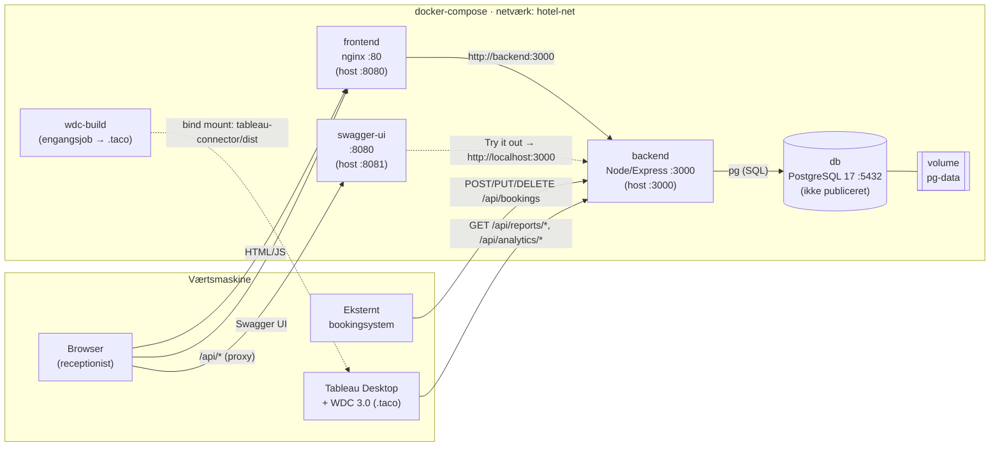
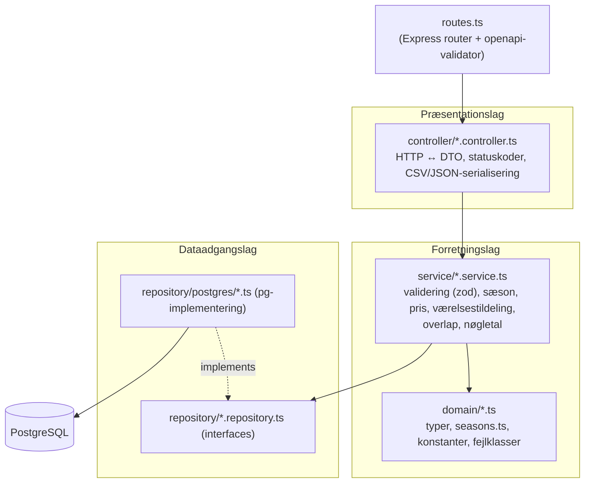

# Implementation Plan: Hotel Kong Arthur – Drift, Booking & Dataanalyse-Platform

**Branch**: `001-hotel-analytics-platform` | **Date**: 2026-10-29 (opdateret 2026-11-02: PostgreSQL og nøgletal i frontenden) | **Spec**: [spec.md](spec.md)

**Input**: Feature specification from `specs/001-hotel-analytics-platform/spec.md`

**Referencedata**: [reference-data.md](reference-data.md) (sæsoner, takster, værelser – eneste kilde)

## Summary

Systemet erstatter de statiske CSV-filer med et transaktionelt booking- og barsystem, der udstiller alle nøgletal live via et REST/JSON API.

- **Backend**: Node.js 22 + TypeScript + Express i tre lag (`controller` → `service` → `repository`) mod PostgreSQL 17. Kunden har fravalgt MySQL (tillægsopgave uge 2, research R-17). Al forretningslogik ligger i service-laget: sæsonudledning, prisberegning, overlapkontrol, værelsestildeling og alle nøgletal.
- **Kontrakt**: Skrives kontrakt-først som `openapi.yaml` (OpenAPI 3.1). Swagger UI-containeren viser den, og backenden validerer requests og (i test) responses mod den. Så kan kontrakt og implementering ikke glide fra hinanden.
- **Frontend**: Vanilla HTML/CSS/JS serveret af nginx med to sider: bookinger (CRUD) og nøgletal for hotel og bar, læst fra `/api/analytics/*` (research R-18). Nginx sender også `/api` videre til backenden.
- **Tableau**: Henter data via en **Web Data Connector 3.0** (`.taco`), der kalder backendens `/api/reports/*`- og `/api/analytics/*`-endpoints. Refresh i Tableau giver straks friske tal fra databasen. CSV-udgaver af de samme rapporter er backup til demoen.
- **Drift**: `docker-compose up` starter `db`, `backend`, `frontend`, `swagger-ui` og `wdc-build`. PostgreSQL har healthcheck og et navngivet volume. Backenden kører migrationer og et idempotent seed af de 1.000 bookinger og 30 drinks ved første opstart.

## Technical Context

**Language/Version**: TypeScript 5.x på Node.js 22 LTS (backend og WDC). Vanilla ES2022 JavaScript i browseren (frontend).

**Primary Dependencies**:
- Backend: `express` 4, `pg` (node-postgres, parametriserede forespørgsler), `zod` (inputvalidering i service-laget), `express-openapi-validator` (kontraktvalidering), `cors`, `csv-parse` (seed), `pino` (logning).
- WDC: `@tableau/taco-toolkit` (WDC 3.0 SDK).
- Frontend: ingen. Statiske filer på `nginx:alpine`.
- Swagger: `swaggerapi/swagger-ui`.

**Storage**: PostgreSQL 17 i Docker med navngivet volume `pg-data`. Skema oprettes af versionerede SQL-migrationer, som backenden kører ved opstart.

**Testing**: Vitest (unit-tests af service-laget med fake repositories), Supertest + `express-openapi-validator` med `validateResponses: true` (integrations- og kontrakttest mod testdatabasen `hotel_kong_arthur_test` i compose-profilen `test`). ESLint + Prettier.

**Target Platform**: Linux-containere (Docker Compose v2) på macOS, Windows og Linux. Tableau Desktop 2023.1+ på værtsmaskinen til WDC 3.0.

**Project Type**: Webapplikation (REST-backend + statisk browser-frontend + Tableau-connector).

**Performance Goals**: Alle analytics- og rapport-endpoints svarer på under 1 s med det seedede datasæt på 1.000 bookinger (NFR-007). Booking-CRUD svarer på under 300 ms.

**Constraints**:
- Ingen klient tilgår databasen direkte. Databasens port publiceres ikke til værten.
- Nøgletal beregnes kun i service-laget. Ingen views, stored procedures eller Tableau-beregnede felter med forretningsregler.
- Bookingskrivninger er transaktionelle med rækkelåse, så samtidige requests ikke kan skabe overlap (NFR-008).
- Kapaciteten er fast 214 værelser / 78.110 værelsesnætter i 2026 og skaleres aldrig.
- Én `docker-compose up` fra et frisk clone, uden manuelle trin (NFR-005, NFR-015).

**Scale/Scope**: 214 værelser, 8 værelsestyper, ~1.000–2.000 bookinger, 30 drinks, ~30 endpoints, 1 frontend-side, 1 Tableau-dashboard. Prototype uden login.

## Constitution Check

*GATE: Must pass before Phase 0 research. Re-check after Phase 1 design.*

| # | Princip / krav (constitution v2.0.0) | Hvordan planen opfylder det | Status |
|---|---|---|---|
| I | 3-lagsarkitektur, ensrettet afhængighed | `backend/src/controller` → `service` → `repository`. Controllere har ingen SQL og ingen beregninger. Services kender kun repository-interfaces, så de kan testes med fakes, og databasen kan udskiftes ved at skifte repository-implementering (det skete i uge 2: MySQL → PostgreSQL) | ✅ |
| II | REST/JSON, OpenAPI 3.x, Swagger UI-container, flertalsnavne, korrekte statuskoder | [contracts/openapi.yaml](contracts/openapi.yaml) er bindende. `swagger-ui`-containeren læser den samme fil. `express-openapi-validator` afviser requests, der ikke matcher kontrakten. Statuskoder 200/201/204/400/404/409 | ✅ |
| II | Eksterne bookingsystemer kan skrive (POST/PUT/DELETE) | `/api/bookings` er åben for alle klienter. Frontenden bruger samme endpoints som et eksternt system | ✅ |
| II | Ingen klient, heller ikke Tableau, tilgår databasen direkte | Tableau bruger WDC 3.0 → REST. PostgreSQL-porten publiceres ikke | ✅ |
| III | `db`, `backend`, `frontend`, `swagger-ui` i compose, healthcheck + `service_healthy`, navngivet volume | Se [Docker-arkitektur](#docker-arkitektur). `wdc-build` er en ekstra engangscontainer | ✅ |
| III | Idempotent automatisk seed ved tom database | Migrationer registreres i tabellen `schema_migrations`. Seed kører kun, hvis `booking` er tom, i én transaktion | ✅ |
| IV | CRUD slår straks igennem i nøgletal | Ingen caching. Hvert analytics-kald læser PostgreSQL og beregner på ny | ✅ |
| IV | Tableau henter via REST (WDC eller rapport-endpoints) | WDC 3.0 primært, CSV-rapporter som backup | ✅ |
| Teknologistak | PostgreSQL i stedet for MySQL | `db` kører `postgres:17`. Kun `repository/postgres/`, migrationer, `env.ts`, `app.ts` og Docker kender databasen | ✅ |
| Teknologistak | Nøgletal læses i API'et og vises i både frontend og Tableau | `frontend/analytics.html` kalder `/api/analytics/*` og beregner intet selv | ✅ |
| IV | Sæson/takster/værelser fra `reference-data.md`, sæson ud fra indtjekning | `domain/seasons.ts` og seed af `room_type` spejler reference-data. Unit-tests låser værdierne fast | ✅ |
| IV | Fast kapacitet, aldrig skaleret | `CAPACITY_ROOMS = 214` er en konstant. Tilgængelige nætter = 214 × dage i perioden | ✅ |
| IV | År på alle data, filtrering på år | `booking.year`, `drink_sale.year`, `?year=` på alle analytics- og rapport-endpoints | ✅ |
| IV | Nøgletal i service-laget, ikke i DB eller Tableau | Repository returnerer rækker. `AnalyticsService` aggregerer i TypeScript. WDC leverer færdigberegnede KPI-tabeller. Fakta-tabellen bruges kun til summering og filtrering i Tableau | ✅ |
| IV | Overlap forhindres i service og via transaktioner | `BookingService` finder ledigt værelse. `SELECT … FOR UPDATE` på værelserne af typen i samme transaktion | ✅ |
| V | Spec → plan → tasks før kode | Ingen kode skrives før `tasks.md` | ✅ |
| V | Unit-tests af prisberegning, sæson, validering, nøgletal; endpoints verificeres mod kontrakt | Vitest + responsvalidering i integrationstest | ✅ |
| – | Linter/formatter, navngivning efter lag | ESLint + Prettier. Filnavne `*.controller.ts`, `*.service.ts`, `*.repository.ts` | ✅ |

**Resultat (før Phase 0)**: Ingen overtrædelser. Complexity Tracking er tom.

**Re-check efter Phase 1**: Datamodellen ([data-model.md](data-model.md)) har ingen views, triggers eller generated columns med forretningslogik. `season`, `nights` og `year` beregnes i service-laget og gemmes som almindelige kolonner. Kontrakten dækker alle FR'er (se [kontraktdækning](#kontraktdækning-fr--endpoint)). ✅ Stadig ingen overtrædelser.

**Re-check 2026-11-02 (constitution 2.0.0)**: Databaseskiftet ændrer kun dataadgangslaget og Docker, og nøgletalsvisningen i frontenden læser kun fra API'et. ✅ Ingen overtrædelser.

## Arkitektur



### Lagdeling i backenden



**Grænser i koden**:
- `controller` må kun importere `service` og `domain`-typer. Den oversætter `DomainError` til HTTP-statuskode (`ValidationError` → 400, `NotFoundError` → 404, `ConflictError` → 409) i en fælles fejl-middleware.
- `service` må kun importere `domain` og repository-**interfaces**. Den kender ikke Express eller `pg`. Transaktioner styres via et `UnitOfWork`-interface (`withTransaction(fn)`).
- `repository/postgres` er det eneste sted, der importerer `pg`, og sammen med `db/` det eneste sted med SQL.
- Wiring sker ét sted, i `app.ts` (manuel dependency injection). Sammen med `config/env.ts` er det det eneste sted uden for `repository/` og `db/`, der skal ændres, når databasen udskiftes (tillægsspørgsmål 5). Skiftet fra MySQL til PostgreSQL i uge 2 er det konkrete eksempel.

**Bevidst placering (eksempel til tillægsspørgsmål 3)**: Overlapkontrollen ligger i `BookingService.assignRoom()` og ikke i en database-trigger eller i frontenden. Repository-laget leverer kun "låste værelser af typen" og "bookinger på værelse X i perioden". Reglen (`ci₁ < co₂ ∧ co₁ > ci₂`) og valget af værelse er forretningslogik og kan unit-testes uden database.

### Hvor beregnes nøgletal (tillægsspørgsmål 4)

- Repository henter **rækker** for det valgte år, f.eks. `SELECT … FROM booking JOIN … WHERE year = ?`.
- `AnalyticsService` laver al aggregering, formler (belægningsgrad, ADR, RevPAR, ALOS), division-med-nul-håndtering og rangering i TypeScript, som rene funktioner.
- Tableau får færdigberegnede KPI-tabeller via WDC. Den eneste aggregering i Tableau er `SUM` over omsætning og nætter i fakta-tabellen, når brugeren filtrerer.
- **Konsekvens af at flytte beregningen**: Til SQL-views ville reglerne blive delt mellem DB og kode og kun kunne testes med en kørende database. Til Tableau ville frontenden og eksterne klienter få andre tal end dashboardet. **Svaghed**: Ved store datamængder er aggregering i applikationen langsommere end i SQL (se research R-07).

### Docker-arkitektur

| Service | Image / build | Host-port | Healthcheck | `depends_on` | Bemærkning |
|---|---|---|---|---|---|
| `db` | `postgres:17` | – (ikke publiceret) | `pg_isready -h 127.0.0.1` (TCP, så init-serveren ikke tæller som klar) | – | Volume `pg-data:/var/lib/postgresql/data`. `db/init/` opretter testdatabasen og testbrugeren. Credentials fra `.env` (defaults i `.env.example` og compose) |
| `backend` | `./backend/Dockerfile` (multi-stage: build → `node:22-alpine`) | `3000` | `wget -qO- http://127.0.0.1:3000/api/health` | `db: service_healthy` | Kører migrationer + seed ved start. Bind-mount af CSV-filerne read-only til `/app/data` og `./api/openapi.yaml` til `/app/openapi.yaml` |
| `frontend` | `./frontend/Dockerfile` (`nginx:alpine`) | `8080` | `wget -qO- http://127.0.0.1/` | `backend: service_healthy` | `nginx.conf`: `location /api/ { proxy_pass http://backend:3000; }` |
| `swagger-ui` | `swaggerapi/swagger-ui` | `8081` | – | – | `SWAGGER_JSON=/spec/openapi.yaml`, bind-mount af `./api` |
| `wdc-build` | `./tableau-connector/Dockerfile` | – | – | – | Engangsjob: `taco build && taco pack` → `./tableau-connector/dist/*.taco`. Exit 0. Blokerer ikke de andre services |
| `backend-test` | `./backend/Dockerfile` (target `test`) | – | – | `db: service_healthy` | Kun i compose-profilen `test`: kører `npm run test:integration` mod den separate testdatabase `hotel_kong_arthur_test`. Starter ikke ved almindelig `docker-compose up` |

- Netværk: `hotel-net` (bridge). Containerne finder hinanden via service-navne (`db`, `backend`).
- Restart: `backend` har `restart: on-failure`, så den prøver igen ved midlertidige DB-fejl.
- `docker-compose down` bevarer data. `docker-compose down -v` nulstiller og giver nyt seed.

### Tableau-integration (WDC 3.0)

- `tableau-connector/` er et taco-toolkit-projekt: `connector.json`, `app/` (lille UI hvor man vælger år og backend-URL, default `http://localhost:3000`) og `handlers/` (fetcher, der kalder API'et, og parser, der mapper JSON til Tableau-tabeller).
- Connectoren leverer flere tabeller i én datakilde:

| WDC-tabel | Kilde-endpoint | Brug i dashboard |
|---|---|---|
| `bookings_fact` | `GET /api/reports/bookings?year=` | Kort over lande, filtre (år, sæson, værelsestype, land, måned), SUM af omsætning og nætter |
| `kpi_summary` | `GET /api/analytics/summary?year=` | KPI-kort: årets indtjening, belægningsgrad, ADR, RevPAR, ALOS, tilfredshed |
| `revenue_room_type_season` | `GET /api/analytics/revenue/room-types?year=` | Indtjening pr. type × sæson, top-værelsestyper |
| `revenue_country` | `GET /api/analytics/revenue/countries?year=` | Indtjening pr. land, top-lande |
| `occupancy_period` | `GET /api/analytics/occupancy?year=` | Belægningsgrad pr. sæson og måned |
| `satisfaction_room_type` | `GET /api/analytics/satisfaction?year=` | Tilfredshed pr. værelsestype |
| `bar_drinks` | `GET /api/analytics/bar?year=` (`drinks[]`) | Omsætning pr. drink |
| `bar_summary` | `GET /api/analytics/bar?year=` (`totals`, `categorySplit[]`) | Helenes total, cocktail vs. kaffe i % |

- Live-demo: opret booking i frontenden → Tableau *Data → Refresh* → connectoren kalder API'et igen → nye tal.
- Backup: alle `/api/reports/*` understøtter `?format=csv`. Filen kan hentes og åbnes i Tableau, hvis WDC fejler på demomaskinen.
- Kørsel kræver Tableau Desktop (Tableau for Students-licens) startet med `-DConnectPluginsPath=<repo>/tableau-connector/dist` og `-DDisableVerifyConnectorPluginSignature=true`, fordi connectoren ikke er signeret (se [quickstart.md](quickstart.md)).

### Kontraktdækning (FR → endpoint)

| FR | Endpoint(s) |
|---|---|
| FR-001, FR-003, FR-004, FR-016, FR-017, FR-018 | `GET/POST /api/bookings`, `GET/PUT/DELETE /api/bookings/{id}` |
| FR-002 | Frontend (`frontend/`) via samme endpoints |
| FR-019 | Frontend (`frontend/analytics.html`) via `GET /api/analytics/*` |
| FR-005 | `GET /api/room-types`, `GET /api/room-types/{id}`, `GET /api/rooms` |
| FR-006 | `GET /api/drinks`, `GET /api/drinks/{id}` |
| FR-007 | `GET/POST /api/drink-sales` |
| FR-008 | `GET /api/analytics/revenue/countries` |
| FR-009, FR-010 | `GET /api/analytics/revenue/room-types`, `GET /api/analytics/revenue/countries` (felt `rank`) |
| FR-011 | `GET /api/analytics/summary`, `GET /api/analytics/occupancy`, `GET /api/analytics/satisfaction` |
| FR-012 | `GET /api/analytics/bar` |
| FR-013 | Seed ved opstart (`backend/src/db/seed.ts`) |
| FR-014 | `api/openapi.yaml` + Swagger UI. Alle nøgletal kan læses direkte som JSON på `/api/analytics/*` |
| FR-015 | `GET /api/reports/bookings`, `GET /api/reports/drink-sales` + WDC 3.0 |

## Project Structure

### Documentation (this feature)

```text
specs/001-hotel-analytics-platform/
├── spec.md              # Specify + Clarify
├── reference-data.md    # Takster, sæsoner, værelser (eneste kilde)
├── plan.md              # Denne fil
├── research.md          # Phase 0: tekniske beslutninger
├── data-model.md        # Phase 1: ER-diagram, tabeller, valideringsregler
├── quickstart.md        # Phase 1: valideringsscenarier end-to-end
├── contracts/
│   └── openapi.yaml     # Phase 1: REST-kontrakt (kopieres til api/openapi.yaml ved implement)
├── checklists/
│   └── requirements.md
└── tasks.md             # Phase 2 (/speckit-tasks – ikke oprettet af plan)
```

### Source Code (repository root)

```text
docker-compose.yml
.env.example
api/
└── openapi.yaml                  # Bindende kontrakt (læses af backend og swagger-ui)
db/
└── init/01-test-database.sql     # Testdatabase + testbruger (kun ved tomt volume)
data/
├── hotel_bookings_2026.csv       # Seed-data (mountes read-only i backend)
└── drinks_menu_with_sales.csv

backend/
├── Dockerfile
├── package.json
├── tsconfig.json
├── vitest.config.ts
├── eslint.config.js
├── src/
│   ├── server.ts                 # Starter: migrate → seed → listen
│   ├── app.ts                    # Express-app + wiring (DI)
│   ├── routes.ts
│   ├── config/env.ts
│   ├── middleware/
│   │   ├── openapi-validator.ts
│   │   └── error-handler.ts      # DomainError → 400/404/409, JSON-fejlformat
│   ├── controller/
│   │   ├── booking.controller.ts
│   │   ├── room.controller.ts        # room-types + rooms
│   │   ├── drink.controller.ts       # drinks + drink-sales
│   │   ├── analytics.controller.ts
│   │   ├── report.controller.ts      # JSON/CSV-rapporter til Tableau
│   │   └── health.controller.ts
│   ├── service/
│   │   ├── booking.service.ts        # validering, pris, sæson, værelsestildeling, overlap
│   │   ├── pricing.service.ts
│   │   ├── room.service.ts
│   │   ├── drink.service.ts
│   │   ├── analytics.service.ts      # alle nøgletal (rene funktioner)
│   │   └── report.service.ts
│   ├── domain/
│   │   ├── types.ts
│   │   ├── seasons.ts                # sæsonperioder fra reference-data.md
│   │   ├── constants.ts              # CAPACITY_ROOMS = 214, ROOM_TYPES
│   │   ├── schemas.ts                # zod-skemaer
│   │   └── errors.ts
│   ├── repository/
│   │   ├── interfaces.ts             # BookingRepository, RoomRepository, …, UnitOfWork
│   │   └── postgres/                 # pg-implementering (erstatter mysql/ fra uge 1)
│   │       ├── pool.ts
│   │       ├── booking.postgres.ts
│   │       ├── guest.postgres.ts
│   │       ├── room.postgres.ts
│   │       ├── room-type.postgres.ts
│   │       ├── drink.postgres.ts
│   │       ├── drink-sale.postgres.ts
│   │       └── unit-of-work.postgres.ts
│   └── db/
│       ├── migrate.ts
│       ├── migrations/
│       │   ├── 001_schema.sql
│       │   └── 002_reference_data.sql   # 8 room_types + 214 rooms
│       └── seed.ts                      # CSV → guest/booking/drink/drink_sale
└── tests/
    ├── unit/                     # services med fake repositories
    │   ├── seasons.test.ts
    │   ├── pricing.test.ts
    │   ├── booking.service.test.ts
    │   └── analytics.service.test.ts
    └── integration/              # supertest + PostgreSQL (compose-profil "test")
        ├── bookings.api.test.ts
        ├── analytics.api.test.ts
        └── seed.test.ts

frontend/
├── Dockerfile
├── nginx.conf
├── index.html                    # Bookingliste + formular (opret/redigér) + slet
├── analytics.html                # Nøgletal for hotel og bar (årsfilter)
├── css/styles.css
└── js/
    ├── api.js                    # fetch-wrapper mod /api
    ├── bookings.js               # UI-logik (ingen forretningsregler)
    └── analytics.js              # Henter /api/analytics/* og viser tal (ingen beregninger)

tableau-connector/
├── Dockerfile                    # node:22 + @tableau/taco-toolkit → taco pack
├── package.json
├── connector.json                # navn, version, tilladte URL'er
├── app/                          # connector-UI (år, backend-URL)
├── handlers/
│   ├── fetcher.ts                # kalder /api/reports/* og /api/analytics/*
│   └── parser.ts                 # JSON → Tableau-tabeller (skemaer pr. tabel)
└── dist/                         # genereret .taco (gitignored)

tableau/
└── hotel-kong-arthur.twb         # Dashboard-workbook (gemmes uden udtræk)

README.md
CONTRIBUTE.md
```

**Structure Decision**: Webapplikation med tre deploybare dele (`backend/`, `frontend/`, `tableau-connector/`) og én delt kontrakt i `api/openapi.yaml`. Backenden følger constitutionens lagnavne direkte i mappestrukturen, så grænserne kan ses i koden og håndhæves med ESLint-reglen `import/no-restricted-paths`.

## Complexity Tracking

> Ingen overtrædelser af constitution. Tabellen er tom.

| Violation | Why Needed | Simpler Alternative Rejected Because |
|-----------|------------|-------------------------------------|
| – | – | – |
